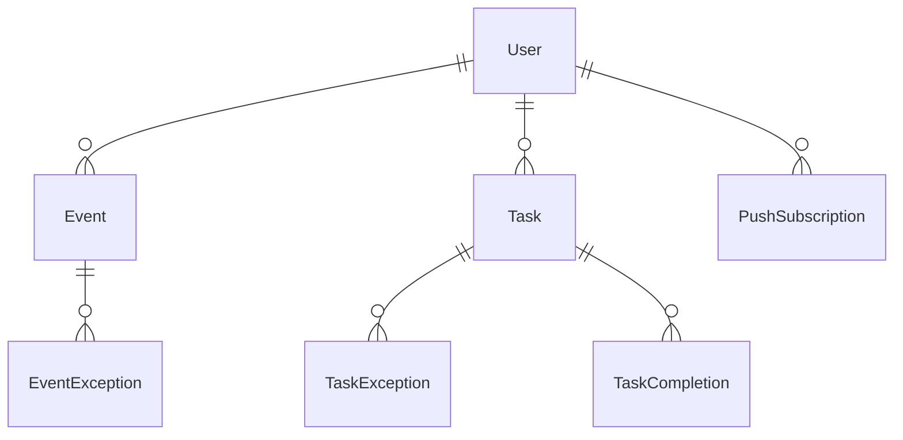

# ✅ Task Master — Project Overview

> A personal planner you open in the morning to see exactly what today holds: timed events, daily to-dos and this week's to-dos. Track what you finish, how long it took and what you worked on, then get a Sunday review of the week so you can improve.

---

## 📑 Table of Contents

- [Problem](#-problem)
- [Target User](#-target-user)
- [Core Features](#-core-features)
- [Recurrence](#-recurrence)
- [Weekly Review](#-weekly-review)
- [Data Model (Rough Draft)](#️-data-model-rough-draft)
- [Tech Stack](#-tech-stack)
- [Architecture](#-architecture)
- [UI / UX](#-ui--ux)
- [Suggested Project Structure](#-suggested-project-structure)
- [Environment Variables](#-environment-variables)
- [Development Workflow](#️-development-workflow)
- [Screenshots](#-screenshots)
- [Roadmap](#-roadmap)
- [Open Questions](#-open-questions)
- [Resources](#-resources)

---

## 📌 Problem

Calendars handle appointments, and to-do apps handle tasks, but neither gives a single morning view of the day, and neither shows how the week actually went. Task Master puts events and to-dos in one place, records what got done (and what didn't), and turns that into a weekly review.

---

## 🧑‍💻 Target User

- **One person (the owner), for personal use.** Multi-user is supported by the data model (every row belongs to a user), but there are no sharing, team or billing features.
- Uses it on a phone and a computer, so it must work well on both and sync through the database.

---

## ✨ Core Features

### A) Today page (home)

- The screen to open in the morning.
- Today's timed events in order, with all-day events at the top.
- Today's daily to-dos and this week's weekly to-dos, each with a checkbox.
- A "Still open from earlier" section listing recent unfinished tasks so they can be ticked off late.

### B) Calendar events

- Title, start and end date/time (or all day), optional location, notes and color.
- Day, week and month views.
- Can repeat (see [Recurrence](#-recurrence)).

### C) To-do lists

- **Daily tasks** belong to one date.
- **Weekly tasks** belong to a week (Monday–Sunday) and can be done any day that week.
- Tick a task done, with optional **time spent** (minutes) and **what I worked on** (a short note).
- Optional priority: low / normal / high.
- **Unfinished tasks stay on their own day or week and count as missed.** They do not roll forward.
- **Late completion:** any past task can be ticked off later. The app records both the date the task was for and when it was ticked, so the review can show "done late".
- Can repeat (see [Recurrence](#-recurrence)).

### D) Weekly review

See [Weekly Review](#-weekly-review).

### E) Notifications (PWA)

- Installable to the home screen on phone and desktop.
- Web push notification on **Sunday at 7pm** (user's timezone): "Your weekly review is ready."
- iPhone only shows web push for apps added to the Home Screen (iOS 16.4+).
- Event reminders are a possible later addition, not in the MVP.

### F) Authentication

- Email + password, or Google account.
- Password reset by email; email verification with an on/off toggle (like DevStash).
- All data is private to the signed-in user.

### G) Settings

- Timezone (defaults to the browser's on first sign-in).
- Review notification on/off.

---

## 🔁 Recurrence

Works the same way for events and tasks, modeled on Google Calendar:

- Does not repeat
- Daily
- Weekly on chosen days (e.g. Mon, Wed, Fri)
- Every weekday (Mon–Fri)
- Monthly (on day N, or on the Nth weekday, e.g. "2nd Tuesday")
- Yearly
- Custom: every N days / weeks / months / years
- Ends: never, on a date, or after N occurrences

Editing or deleting one occurrence of a repeating item asks: **This one only**, **This and following**, or **All**.

- **This one only** → an exception row for that occurrence (changed or cancelled).
- **This and following** → end the original rule the day before and create a new item from that date.
- **All** → update the item itself.

Rules are stored as **RRULE strings** (RFC 5545, the Google Calendar format) and expanded with the `rrule` library. Occurrences are generated when a day, week or month is displayed. They are not stored as rows, except completions and exceptions.

---

## 📊 Weekly Review

One review per week (Monday–Sunday), with history so past weeks can be browsed.

- **Completion rate** (done / planned), overall and split into daily vs. weekly tasks
- **Done** and **missed** lists, with "done late" marked
- **Time spent**: total, and per task
- **Most-missed repeating tasks**
- **Comparison with the previous week** (completion rate and time spent)
- **"What I worked on" notes** from the week, in order

The review is **calculated from live data** when the page loads, so ticking off a task late updates that week's numbers. The Sunday cron job only sends the notification; it does not freeze a snapshot.

---

## 🗄️ Data Model (Rough Draft)

Prisma schema sketch. Better Auth manages `User`, `Session`, `Account` and `Verification`; the app adds fields to `User`.

```prisma
model User {
  id            String   @id
  name          String
  email         String   @unique
  emailVerified Boolean  @default(false)
  image         String?
  timezone      String?  // IANA name, e.g. "America/New_York"; null until set from the browser (treated as UTC)
  reviewNotify  Boolean  @default(true)
  createdAt     DateTime @default(now())
  updatedAt     DateTime @updatedAt

  sessions          Session[]
  accounts          Account[]
  events            Event[]
  tasks             Task[]
  pushSubscriptions PushSubscription[]
}

// Session, Account, Verification: generated by the Better Auth CLI

enum EventColor {
  BLUE
  GREEN
}

model Event {
  id         String    @id @default(cuid())
  userId     String
  title      String
  notes      String?
  location   String?
  color      EventColor @default(BLUE)
  allDay     Boolean   @default(false)
  startAt    DateTime  // UTC; for all-day events, the first day at 00:00 UTC (read back as a UTC date, never in the user's timezone)
  endAt      DateTime  // UTC; for all-day events, the day after the last day at 00:00 UTC (exclusive)
  rrule      String?   // null = does not repeat
  createdAt  DateTime  @default(now())
  updatedAt  DateTime  @updatedAt

  user       User      @relation(fields: [userId], references: [id], onDelete: Cascade)
  exceptions EventException[]

  @@index([userId, startAt])
}

model EventException {
  id             String   @id @default(cuid())
  eventId        String
  occurrenceStart DateTime // original start of the occurrence being changed
  cancelled      Boolean  @default(false)
  title          String?  // overrides, null = unchanged
  startAt        DateTime?
  endAt          DateTime?
  notes          String?
  location       String?

  event Event @relation(fields: [eventId], references: [id], onDelete: Cascade)

  @@unique([eventId, occurrenceStart])
}

enum TaskScope {
  DAILY
  WEEKLY
}

enum Priority {
  LOW
  NORMAL
  HIGH
}

model Task {
  id        String    @id @default(cuid())
  userId    String
  title     String
  notes     String?
  scope     TaskScope
  priority  Priority  @default(NORMAL)
  date      DateTime  @db.Date // DAILY: the day; WEEKLY: the Monday of the week (first occurrence if repeating)
  rrule     String?
  createdAt DateTime  @default(now())
  updatedAt DateTime  @updatedAt

  user        User             @relation(fields: [userId], references: [id], onDelete: Cascade)
  completions TaskCompletion[]
  exceptions  TaskException[]

  @@index([userId, date])
}

model TaskException {
  id             String   @id @default(cuid())
  taskId         String
  occurrenceDate DateTime @db.Date
  cancelled      Boolean  @default(false)
  title          String?
  date           DateTime? @db.Date // moved to another day

  task Task @relation(fields: [taskId], references: [id], onDelete: Cascade)

  @@unique([taskId, occurrenceDate])
}

model TaskCompletion {
  id             String   @id @default(cuid())
  taskId         String
  occurrenceDate DateTime @db.Date // which day/week the task was for
  completedAt    DateTime @default(now()) // when it was ticked (UTC)
  minutesSpent   Int?
  workNote       String?

  task Task @relation(fields: [taskId], references: [id], onDelete: Cascade)

  @@unique([taskId, occurrenceDate])
}

model PushSubscription {
  id        String   @id @default(cuid())
  userId    String
  endpoint  String   @unique
  p256dh    String
  auth      String
  createdAt DateTime @default(now())

  user User @relation(fields: [userId], references: [id], onDelete: Cascade)
}
```

### Entity relationships



- "Done late" = `completedAt` (in the user's timezone) falls after the end of the occurrence's day (daily) or week (weekly).
- Unticking a task deletes its `TaskCompletion` row.

---

## 🧱 Tech Stack

| Category | Choice | Notes |
| --- | --- | --- |
| ⚛️ Framework | [Next.js](https://nextjs.org/docs) (App Router, React 19) | Server Components + Server Actions |
| 🟦 Language | [TypeScript](https://www.typescriptlang.org/docs/) | Strict mode |
| 🐘 Database | [Neon](https://neon.tech/docs) PostgreSQL | `development` and `production` branches |
| 🔺 ORM | [Prisma](https://www.prisma.io/docs) | Neon driver adapter, migrations, seed |
| 🔐 Auth | [Better Auth](https://www.better-auth.com/docs) | Email/password + Google, Prisma adapter |
| 📧 Email | [Resend](https://resend.com/docs) | Verification and password reset emails |
| 🔁 Recurrence | [rrule](https://github.com/jkbrzt/rrule) | RFC 5545 rules |
| 🕒 Dates | [date-fns](https://date-fns.org/) + [@date-fns/tz](https://github.com/date-fns/tz) | Timezone-aware date math |
| 🎨 CSS / UI | [Tailwind CSS v4](https://tailwindcss.com/docs) + [shadcn/ui](https://ui.shadcn.com/) | Icons via [Lucide](https://lucide.dev/) |
| ✅ Validation | [Zod](https://zod.dev/) | Shared schemas for forms & server actions |
| 🔔 Push | Web Push API + [web-push](https://github.com/web-push-libs/web-push) | Service worker, VAPID keys |
| ⏰ Scheduled jobs | [Vercel Cron](https://vercel.com/docs/cron-jobs) | Hourly check that sends Sunday 7pm notifications per timezone |
| 🧪 Unit testing | [Vitest](https://vitest.dev/) | Server actions and utilities only, not components |
| 🚀 Deployment | [Vercel](https://vercel.com/docs) | |

---

## 🔌 Architecture

### System overview

```
Browser / installed PWA
   │  Server Components (reads)  ·  Server Actions (writes)
   ▼
Next.js on Vercel ──► Prisma ──► Neon Postgres
   │
   ├─ /api/auth/[...all]   Better Auth handler
   ├─ /api/cron/review     Vercel Cron (hourly) → web-push
   └─ service worker       receives push, opens /review
```

### 🔐 Auth flow

1. Sign up with email/password (verification email via Resend when enabled) or Google.
2. Better Auth stores sessions in the database; the session cookie is read server-side.
3. `src/proxy.ts` redirects signed-out users to `/sign-in`; every server action and query also checks the session and filters by `userId`.

### 📅 Occurrence flow

1. A page asks for a date range (a day, week or month, in the user's timezone).
2. `src/lib/db/*` loads items whose rule could produce occurrences in that range, plus their exceptions and completions.
3. `src/lib/recurrence.ts` expands each rule into occurrences, applies exceptions, and attaches completions.
4. The page renders plain occurrence objects.

### 🔔 Review notification flow

1. Vercel Cron calls `/api/cron/review` every hour (protected by `CRON_SECRET`).
2. For each user where it's currently Sunday 19:00–19:59 in their timezone and `reviewNotify` is on, send a push to each subscription.
3. Expired subscriptions (HTTP 404/410) are deleted.

---

## 🎨 UI / UX

- Clean, calm, minimal. Mobile first: the Today page must be usable one-handed on a phone.
- Dark and light mode, following the system setting by default (switchable in Settings). Designed dark first.
- Large tap targets for checkboxes.
- Completing a task: tick, then an optional small "time spent / what I worked on" prompt that can be skipped.
- Blue is the main color (actions, navigation, current item); green always means done; orange means missed or late. Fonts: IBM Plex Sans and IBM Plex Mono. Full tokens in `context/mockup/README.md` (see [Screenshots](#-screenshots)).

### Layout

- **Desktop:** left sidebar (Today, Calendar, To-dos, Review, Settings), main content area.
- **Mobile:** bottom tab bar with the same sections; a floating "+" button to add a task or event.

### Pages

| Route | Page |
| --- | --- |
| `/sign-in`, `/sign-up`, `/forgot-password`, `/reset-password` | Auth |
| `/today` | Today page (home after sign-in) |
| `/calendar?view=day\|week\|month&date=YYYY-MM-DD` | Calendar |
| `/todos?date=YYYY-MM-DD` | Daily and weekly lists for a day/week, including past ones |
| `/review` and `/review/[weekStart]` | This week's review and past weeks |
| `/settings` | Timezone, notifications, account |

---

## 📁 Suggested Project Structure

```
src/
  app/
    (auth)/sign-in, sign-up, forgot-password, reset-password
    (app)/today, calendar, todos, review, settings
    api/auth/[...all]/route.ts
    api/cron/review/route.ts
  actions/            # server actions: tasks.ts, events.ts, completions.ts, settings.ts, push.ts
  components/
    ui/               # shadcn primitives
    today/ calendar/ todos/ review/ layout/
  lib/
    auth.ts           # Better Auth server config
    auth-client.ts    # Better Auth client
    session.ts        # getSession, getCurrentUserId, requireUser
    env.ts            # Zod-validated environment variables
    prisma.ts
    recurrence.ts     # rrule expansion + exceptions
    dates.ts          # timezone + week helpers
    review.ts         # weekly review calculations
    db/               # queries: tasks.ts, events.ts, review.ts
    validations/      # zod schemas
  hooks/              # custom hooks: use-[name].ts
  types/              # includes actions.ts (ActionResult<T>)
  proxy.ts
prisma/
  schema.prisma
  seed.ts
public/
  manifest.webmanifest
  sw.js
```

---

## 🔑 Environment Variables

```bash
# Database
DATABASE_URL=          # Neon pooled connection (app)
DIRECT_URL=            # Neon direct connection (Prisma CLI)

# App
APP_URL=http://localhost:3000

# Better Auth
BETTER_AUTH_SECRET=
BETTER_AUTH_URL=http://localhost:3000
GOOGLE_CLIENT_ID=
GOOGLE_CLIENT_SECRET=

# Email (Resend)
RESEND_API_KEY=
EMAIL_VERIFICATION_ENABLED=false

# Web Push
NEXT_PUBLIC_VAPID_PUBLIC_KEY=
VAPID_PRIVATE_KEY=
VAPID_SUBJECT=mailto:you@example.com

# Cron
CRON_SECRET=
```

---

## 🗂️ Development Workflow

- 🌿 One branch per feature (`feature/[name]`) or fix (`fix/[name]`)
- 📝 Each feature starts as a spec in `context/features/`, loaded with `/feature load`
- 🐘 Neon `development` branch for local work; `production` only for the deployed app
- 🧪 Vitest unit tests for server actions and utilities (`npm test`), especially dates, recurrence and review math
- ✅ `npm run build` and `npm test` must pass before committing

---

## 📸 Screenshots

The agreed UI mockup. Use it as the reference for layout, copy and colors; it does not have to be pixel-exact.

- **Design tokens, fonts and rules:** @context/mockup/README.md
- **Mockup source** (read for layout and behavior, don't copy the markup): `context/mockup/app-desktop.html`, `context/mockup/today-phone.html`, `context/mockup/sign-in.html`
- **Screenshots:** `context/screenshots/` (light and dark, desktop and phone)
- **Live canvas:** https://claude.ai/artifact/WZ6vtoJNekshgK1kjFLpzp

---

## 🧭 Roadmap

Each item is one spec in `context/features/`, built in order with `/feature load <name>` (for example `/feature load 01-project-setup-spec`). Each is sized to fit comfortably in one session.

### 🟢 Phase 1 — MVP

- [x] UI mockup
- [x] `01-project-setup-spec`: Next.js, Tailwind tokens, shadcn, fonts, dark mode, Vitest
- [x] `02-database-setup-spec`: Prisma + Neon, first `User` model
- [x] `03-auth-email-password-spec`: Better Auth, sign-in/sign-up, route protection
- [x] `04-auth-google-spec`: Sign in with Google
- [x] `05-auth-email-verification-reset-spec`: Resend, verification toggle, password reset
- [x] `06-app-shell-spec`: sidebar, bottom tabs, header, Settings
- [x] `07-dates-lib-spec`: timezone, week and formatting helpers
- [x] `08-tasks-backend-spec`: tasks + completions model, actions, seed
- [x] `09-todos-page-spec`: week strip, daily/weekly lists, ticking, late completion
- [x] `10-task-details-spec`: time spent and notes
- [x] `11-events-backend-spec`: events model, actions, seed
- [ ] `12-new-item-dialog-spec`: New task/event dialog, event details
- [ ] `13-calendar-week-day-spec`: week and day views
- [ ] `14-calendar-month-spec`: month view
- [ ] `15-recurrence-core-spec`: RRULE storage and expansion engine
- [ ] `16-recurrence-ui-spec`: repeat presets and custom options
- [ ] `17-recurrence-edit-scope-spec`: this / following / all
- [ ] `18-today-page-spec`: morning overview, desktop and phone
- [ ] `19-weekly-review-calc-spec`: review calculations
- [ ] `20-weekly-review-page-spec`: review page and history

### 🟣 Phase 2 — PWA and launch

- [ ] `21-pwa-spec`: installable app
- [ ] `22-push-notifications-spec`: Sunday review notification
- [ ] `23-deploy-spec`: Vercel + Neon production

### 🔮 Future Enhancements

- [ ] Event reminders
- [ ] Drag-and-drop rescheduling in the calendar
- [ ] Google Calendar import / sync
- [ ] Task categories or tags, with review stats per category
- [ ] Data export (JSON / CSV)

---

## ❓ Open Questions

- Should weekly tasks also be pinnable to a specific day while still counting for the week?
- Should the review count cancelled occurrences of repeating tasks as planned? (Default: no.)
- Is there any limit on how far back late completion is allowed? (Default: no limit.)

---

## 📚 Resources

- [Next.js Docs](https://nextjs.org/docs)
- [Prisma Docs](https://www.prisma.io/docs) · [Neon + Prisma](https://neon.tech/docs/guides/prisma)
- [Better Auth Docs](https://www.better-auth.com/docs) · [Prisma adapter](https://www.better-auth.com/docs/adapters/prisma)
- [rrule](https://github.com/jkbrzt/rrule) · [RFC 5545](https://datatracker.ietf.org/doc/html/rfc5545)
- [Tailwind CSS Docs](https://tailwindcss.com/docs) · [shadcn/ui](https://ui.shadcn.com/)
- [Web Push on iOS](https://webkit.org/blog/13878/web-push-for-web-apps-on-ios-and-ipados/)
